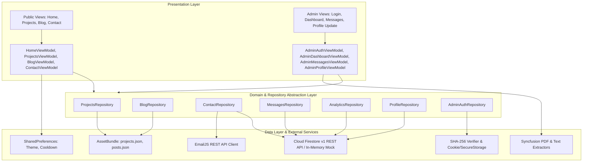

# Functional Requirements Document (FRD)
## Project: Folio — Personal Portfolio & Admin Console

---

### Document Information
- **Product Name**: Folio (Flutter Web Personal Portfolio & Admin Console)
- **Document Version**: 1.0.0
- **Document Status**: Approved / Technical Specification Baseline
- **Format**: Markdown (.md)
- **Author**: Lead Systems Analyst & Technical Architect
- **Target Audience**: Backend Engineering Team (Node.js API Developers), Frontend Engineers, QA Engineers, DevOps Engineers

---

## 1. Introduction & System Overview

### 1.1 Purpose
This Functional Requirements Document (FRD) provides the authoritative, feature-by-feature technical specification for the **Folio** platform. It details the exact behaviors, algorithms, state management workflows, validation logic, entity schemas, persistence contracts, external integrations, and security controls as implemented in the Flutter Web codebase (`c:\projects\follio`).

This specification serves as the formal functional blueprint for migrating client-side mock/hybrid persistence into a dedicated Node.js/TypeScript backend API.

### 1.2 System Architecture Overview
The Folio application is structured as a layered Clean Architecture implementation utilizing the **Provider-based MVVM (Model-View-ViewModel)** design pattern. It enforces complete separation between UI views, presentation ViewModels, domain contracts (repositories/use cases), and data layers (datasources, REST clients, local storage).



### 1.3 State Management & ViewState Protocol
All ViewModels extend `ChangeNotifier` and strictly forbid local `StatefulWidget.setState()` for domain or business state. UI state rendering follows an explicit four-branch **ViewState** contract:
1. **`ViewState.idle`**: Default quiescent state. UI renders interactive inputs, static content, or populated forms.
2. **`ViewState.loading`**: Active asynchronous operation. UI renders animated skeletons, progress spinners, or disables submission buttons to prevent duplicate triggers.
3. **`ViewState.success`**: Operation completed successfully. UI renders confirmed data, updates badges, or displays success confirmation views.
4. **`ViewState.error`**: Operation encountered a handled or unhandled exception. UI renders alert banners, contextual error text, and exposes retry triggers.

---

## 2. Functional Requirements by Module

---

### Module 1: Architecture, Routing & Flavor Isolation

#### FR-001: Build-Time Target Differentiation via Flavors
- **Description**: The system must enforce build-time target configuration through Flutter Flavors (`Flavor.user` vs `Flavor.admin`), establishing independent entry points (`main_user.dart` and `main_admin.dart`).
- **Preconditions**: Target flavor specified during compilation (e.g., `--target lib/main_user.dart` or `--target lib/main_admin.dart`).
- **Trigger**: Application bootstrap.
- **Exact Processing Steps**:
  1. Entry point initializes Flutter widget binding (`WidgetsFlutterBinding.ensureInitialized()`).
  2. Entry point configures `AppConfig(flavor: Flavor.user | Flavor.admin)`.
  3. Entry point instantiates the dependency injection tree (`MultiProvider`) with flavor-specific dependencies.
  4. Router (`AppRouter.createRouter(flavor)`) compiles declarative routes based on the active flavor.
- **Outputs / Results**: Application initializes with strictly defined routes and navigational boundaries.
- **Error & Edge Cases**: If an invalid or unconfigured flavor is supplied, router defaults to public user mode without admin route bindings.

#### FR-002: Public Route Hard Barrier in User Flavor
- **Description**: In `Flavor.user`, all paths prefixed with `/admin` must be inaccessible and immediately redirect to `/404`.
- **Preconditions**: Application running with `Flavor.user`.
- **Trigger**: Visitor navigates directly (via browser address bar or link) to any URI starting with `/admin` (e.g., `/admin`, `/admin/login`, `/admin/dashboard`).
- **Exact Processing Steps**:
  1. `GoRouter` intercepts navigation request in `redirect(BuildContext context, GoRouterState state)`.
  2. Router inspects `state.matchedLocation`.
  3. If `state.matchedLocation.startsWith('/admin')`, router aborts navigation and returns string `'/404'`.
- **Outputs / Results**: Browser navigates to `NotFoundView` (`/404`). Administrative routes are completely hidden and unrendered.
- **Error & Edge Cases**: Deep-link queries (e.g., `/admin/dashboard?token=xyz`) match prefix and redirect to `/404`.

#### FR-003: Administrative Gateway Barrier in Admin Flavor
- **Description**: In `Flavor.admin`, visitors must not access public showcase routes (`/`, `/projects`, `/blog`, `/contact`), redirecting to `/admin/login`.
- **Preconditions**: Application running with `Flavor.admin`.
- **Trigger**: User navigates to root `/` or any public sub-route.
- **Exact Processing Steps**:
  1. `GoRouter` redirect handler inspects `state.matchedLocation`.
  2. If `state.matchedLocation == '/'` or is a public route, router checks `AuthGuard.redirect()`.
  3. If user is unauthenticated, router returns `'/admin/login'`.
  4. If user is authenticated, router returns `'/admin/dashboard'`.
- **Outputs / Results**: Browser redirects to `/admin/login` (unauthenticated) or `/admin/dashboard` (authenticated).
- **Error & Edge Cases**: Direct deep link to `/projects/novu-dashboard` redirects to `/admin/login`.

#### FR-004: Protected ShellRoute & Administrative Route Guard
- **Description**: Administrative screens (`/admin/dashboard`, `/admin/messages`, `/admin/profile-update`) must be nested within a protected `ShellRoute` governed by `AuthGuard`.
- **Preconditions**: Application running with `Flavor.admin`.
- **Trigger**: Navigation event targeting `/admin/dashboard`, `/admin/messages`, or `/admin/profile-update`.
- **Exact Processing Steps**:
  1. `AuthGuard.redirect` reads `AdminAuthProvider.isAuthenticated`.
  2. If `isAuthenticated == false`:
     - Preserves intended destination in router state.
     - Redirects user to `'/admin/login'`.
  3. If `isAuthenticated == true`:
     - If current destination is `'/admin/login'`, redirects to `'/admin/dashboard'`.
     - Otherwise, allows navigation to proceed to the target shell view.
- **Outputs / Results**: Authorized users access the requested admin screen rendered inside `AdminShell` (navigation sidebar, topbar, active user avatar). Unauthorized users are blocked at `/admin/login`.
- **Error & Edge Cases**: Session expiry during route transition immediately triggers redirect to `/admin/login`.

#### FR-005: 404 Route Fallback
- **Description**: Any unrecognized route path in either flavor must render a dedicated Not Found screen (`NotFoundView`).
- **Preconditions**: Application initialized.
- **Trigger**: User enters a route that matches no configured `GoRoute`.
- **Exact Processing Steps**:
  1. `GoRouter.errorBuilder` is invoked with `BuildContext` and `GoRouterState`.
  2. Router instantiates `NotFoundView(uri: state.uri.toString())`.
  3. View presents a clear error message and a CTA button ("Return Home" linking to `/` in user flavor or `/admin/login` in admin flavor).
- **Outputs / Results**: Clean 404 error page displayed; no uncaught router exceptions.
- **Error & Edge Cases**: Malformed URI encoding handled gracefully without application crash.

---

### Module 2: Public Portfolio Showcase

#### FR-006: Hero Presentation & Availability Indicator
- **Description**: The home view must present an executive hero section displaying personal branding, professional headline, dynamic availability status, career metrics, and primary CTAs.
- **Preconditions**: Home view loaded (`/`).
- **Trigger**: Initial page render or navigation to `/`.
- **Exact Processing Steps**:
  1. `HomeViewModel` loads active profile data from `ProfileRepository`.
  2. UI binds name ("Eliott"), headline ("Product Designer & Frontend Developer"), and availability badge ("Available for work" with green pulse dot).
  3. Metric cards display static highlights: "34+ Projects Done", "21+ Happy Clients", "5y Experience".
  4. "View my work" button triggers smooth scroll to `#projects` section.
  5. "Get in touch" button triggers smooth scroll to `#contact` section.
- **Outputs / Results**: Interactive Hero section rendered with responsive desktop/tablet/mobile layouts.
- **Error & Edge Cases**: If profile data fails to load, fallback static defaults are rendered without blocking UI display.

#### FR-007: Core Competencies & Service Offerings
- **Description**: The system must display three distinct service offerings highlighting key disciplines, tools, and deliverables.
- **Preconditions**: Home view loaded (`/`).
- **Trigger**: User scrolls to `#services` section.
- **Exact Processing Steps**:
  1. System renders three interactive service cards:
     - **UI/UX Design**: User research, wireframing, interactive prototyping, design systems in Figma.
     - **Frontend Development**: Responsive web development, Flutter Web, React, animations, state management.
     - **Landing Pages**: High-conversion landing page design, SEO optimization, performance tuning.
  2. Micro-interactions: Cards feature hover elevation, border gradient transitions, and responsive grid stacking.
- **Outputs / Results**: Visual presentation of service capabilities.
- **Error & Edge Cases**: Card layouts stack into single column on mobile viewports (< 768px).

#### FR-008: Featured Project Showcase & Category Filtering
- **Description**: The system must display curated portfolio projects on the home screen and a comprehensive project directory on the dedicated archive screen (`/projects`), supporting industry category filtering.
- **Preconditions**: `ProjectsRepository` initialized with `assets/data/projects.json`.
- **Trigger**: Home view scroll to `#projects` or navigation to `/projects`.
- **Exact Processing Steps**:
  1. `ProjectsViewModel.loadProjects()` parses `projects.json`.
  2. UI displays category filter pills: `All`, `SaaS`, `Fintech`, `Agency`, `Mobile`, `E-Commerce`.
  3. When user taps a category pill:
     - `ProjectsViewModel.setCategory(category)` updates `_selectedCategory`.
     - Filter algorithm filters list: `projects.where((p) => category == 'All' || p.category == category)`.
     - ViewState notifies listeners, re-rendering project cards with fade transition.
  4. Project cards display thumbnail image, title, summary, client name, industry badge, and tech stack tags.
- **Outputs / Results**: Filtered list of projects displayed with instant client-side responsiveness.
- **Error & Edge Cases**: If no projects match selected category, an empty state message ("No projects found in this category") is rendered.

#### FR-009: Detailed Case Study Presentation
- **Description**: Visitors can inspect deep-linked project case studies (`/projects/:slug`) presenting business impact, problem definitions, technical architecture, and client testimonials.
- **Preconditions**: Project exists in `projects.json` matching `:slug`.
- **Trigger**: User clicks a project card or navigates directly to `/projects/:slug`.
- **Exact Processing Steps**:
  1. `ProjectDetailViewModel.loadProjectBySlug(slug)` queries `ProjectsRepository`.
  2. System resolves matching `ProjectModel`:
     - Key Metrics: (e.g., "+40% Conversion", "-25% Churn").
     - Metadata: Client, Timeline, Role, Deliverables.
     - Narrative Sections: Problem statement, research approach, solution architecture, design system.
     - Gallery: Responsive image showcase with zoom/lightbox.
     - Testimonial: Direct quote from project stakeholder.
  3. Renders sticky back navigation linking to `/projects`.
- **Outputs / Results**: Full-width long-form case study view rendered.
- **Error & Edge Cases**: If slug is not found in asset store, view transitions to `ViewState.error`, displaying "Project not found" and a return button.

#### FR-010: Dynamic Biography & Skills Roster
- **Description**: The "About" section must dynamically display the creator's bio paragraphs and technology badges from the active profile store.
- **Preconditions**: Home view loaded (`/`).
- **Trigger**: User scrolls to `#about` section.
- **Exact Processing Steps**:
  1. `HomeViewModel` binds `_activeProfile` from `ProfileRepository.getActiveProfile()`.
  2. Bio section displays:
     - Intro bio paragraph.
     - Design philosophy paragraph.
  3. Skills section renders a wrap grid of technology pill badges (e.g., "Flutter", "Figma", "Dart", "Tailwind CSS", "TypeScript", "Firebase").
  4. Experience timeline shows career milestones and education.
- **Outputs / Results**: Dynamically populated bio and skills reflecting latest admin publications.
- **Error & Edge Cases**: If active profile is empty, fallback content from bundled seed profile is displayed.

#### FR-011: Social Proof & Client Testimonials
- **Description**: The system must display client testimonials with author names, roles, company logos, and 5-star rating indicators.
- **Preconditions**: Home view loaded (`/`).
- **Trigger**: User scrolls to `#testimonials` section.
- **Exact Processing Steps**:
  1. `HomeViewModel` loads testimonials from bundled repository.
  2. UI renders testimonial carousel / grid containing quotes, client avatar, client name, position, and verified star rating.
- **Outputs / Results**: Testimonials rendered with responsive pagination/scrolling.
- **Error & Edge Cases**: Missing client avatar falls back to initials monogram.

#### FR-012: Editorial Thought Leadership (Blog & Article Reader)
- **Description**: Visitors can browse articles on `/blog`, filter by category (`All`, `Design`, `Dev`, `Freelance`), and read individual articles (`/blog/:slug`) with a reading progress indicator and social sharing links.
- **Preconditions**: `BlogRepository` initialized with `assets/data/posts.json`.
- **Trigger**: Navigation to `/blog` or `/blog/:slug`.
- **Exact Processing Steps**:
  1. `/blog` view: `BlogViewModel.loadPosts()` loads articles; user can search by title or filter by category tag.
  2. `/blog/:slug` view: `BlogPostViewModel.loadPostBySlug(slug)` displays markdown/rich content, author, date, and estimated reading time (e.g., "5 min read").
  3. Reading progress bar: Top-pinned linear progress bar dynamically recalculates fill width based on viewport scroll offset:
     $$\text{Progress} = \frac{\text{ScrollOffset}}{\text{MaxScrollExtent}}$$
  4. Social sharing buttons generate pre-populated sharing URLs for X/Twitter (`https://twitter.com/intent/tweet?text=...&url=...`) and LinkedIn (`https://www.linkedin.com/sharing/share-offsite/?url=...`).
- **Outputs / Results**: Full editorial reading experience with interactive social distribution triggers.
- **Error & Edge Cases**: Invalid slug displays "Article not found" with button to return to `/blog`.

---

### Module 3: Contact Form & Inbound Inquiries

#### FR-013: Contact Form Input Fields & Real-Time Validation
- **Description**: The contact section (`/contact` or `#contact`) must provide an inquiry submission form with strict client-side validation rules.
- **Preconditions**: Contact form rendered.
- **Trigger**: User edits form fields or clicks "Send Message".
- **Exact Processing Steps**:
  1. Form fields:
     - **Name**: Required, trimmed length between 2 and 60 characters.
     - **Email**: Required, validated against RFC 5322 regex:
       `^[a-zA-Z0-9._%+-]+@[a-zA-Z0-9.-]+\.[a-zA-Z]{2,}$`
     - **Subject**: Optional, maximum 120 characters. Defaults to `'Portfolio Contact Inquiry'` for EmailJS and `'General Inquiry'` for database store if left blank.
     - **Message**: Required, trimmed length between 10 and 2000 characters.
     - **Honeypot (`website`)**: Hidden text input field (rendered with `opacity: 0.0` and zero size, offscreen tabindex).
  2. Real-time validation updates field error state upon loss of focus or submission attempt.
- **Outputs / Results**: Validation error strings rendered under invalid fields. Submission button disabled or blocked if invalid.
- **Error & Edge Cases**: Whitespace-only strings in Name or Message are treated as empty.

#### FR-014: Invisible Honeypot Anti-Spam Trap
- **Description**: Form submissions with a populated honeypot field must be silently intercepted and neutralized without sending emails or writing to database.
- **Preconditions**: Contact form submitted.
- **Trigger**: User (bot) populates the hidden `website` input field.
- **Exact Processing Steps**:
  1. `ContactViewModel.submit()` reads `_honeypotController.text`.
  2. If `_honeypotController.text.trim().isNotEmpty`:
     - System bypasses `ContactRepository.sendMessage()`.
     - System artificially delays response by 600ms (to emulate legitimate network latency).
     - System updates ViewModel state to `ViewState.success`.
     - UI renders the standard success message ("Thank you! Your message has been sent.").
     - No network request is dispatched to EmailJS.
     - No write operation is made to Firestore or in-memory message store.
- **Outputs / Results**: Bot is deceived into believing the submission succeeded; zero spam enters owner inbox or database.
- **Error & Edge Cases**: None. Legitimate human users never see or populate the field.

#### FR-015: Client-Side Rate-Limiting Cooldown
- **Description**: The system must enforce a mandatory 60-second cooldown period between consecutive contact submissions from the same browser.
- **Preconditions**: Contact form submitted.
- **Trigger**: User attempts to submit contact form.
- **Exact Processing Steps**:
  1. `ContactRepositoryImpl` queries `SharedPreferences` for key `portfolio_last_contact_submit_ms`.
  2. If key exists:
     $$\Delta t = \text{CurrentTimeMs} - \text{StoredTimeMs}$$
  3. If $\Delta t < 60,000 \text{ ms}$:
     - Subtraction yields remaining seconds:
       $$\text{RemainingSeconds} = \left\lceil \frac{60000 - \Delta t}{1000} \right\rceil$$
     - Method immediately throws `RateLimitFailure('Please wait $RemainingSeconds seconds before sending another message.')`.
     - ViewModel catches failure, transitions to `ViewState.error`, and renders countdown alert.
  4. If $\Delta t \ge 60,000 \text{ ms}$ or key does not exist:
     - Submission proceeds.
     - Upon successful delivery, system records `DateTime.now().millisecondsSinceEpoch` into `portfolio_last_contact_submit_ms`.
- **Outputs / Results**: Abuse prevention with user-friendly countdown timer.
- **Error & Edge Cases**: User clears browser cookies/localStorage: cooldown resets. (Documented in open questions for server-side rate limiting).

#### FR-016: EmailJS Notification Dispatch
- **Description**: Legitimate contact inquiries must be formatted into an EmailJS payload and dispatched via HTTP POST to the EmailJS REST API.
- **Preconditions**: Valid form data, honeypot empty, rate-limit check passed.
- **Trigger**: User triggers submission.
- **Exact Processing Steps**:
  1. `ContactRemoteDataSourceImpl.sendContactMessage(dto)` constructs HTTP POST request:
     - **Endpoint**: `https://api.emailjs.com/api/v1.0/email/send`
     - **Headers**: `{'Content-Type': 'application/json'}`
     - **JSON Body**:
       ```json
       {
         "service_id": "service_folio",
         "template_id": "template_folio_contact",
         "user_id": "<EMAILJS_PUBLIC_KEY>",
         "template_params": {
           "from_name": "<name>",
           "from_email": "<email>",
           "subject": "<subject>",
           "message": "<message>",
           "reply_to": "<email>"
         }
       }
       ```
  2. HTTP Client dispatches request with a **15-second timeout**.
  3. If response status code is 200: request succeeds.
  4. If response status code is non-200: throws `ServerFailure('Email service failed: ${response.statusCode}')`.
- **Outputs / Results**: Email successfully dispatched to the portfolio owner's mailbox.
- **Error & Edge Cases**: Unreachable host or invalid service credentials return explicit `ServerFailure`.

#### FR-017: Resilient Retry Strategy for EmailJS Dispatch
- **Description**: Transient network faults or timeouts during EmailJS dispatch must be automatically retried before reporting an error.
- **Preconditions**: EmailJS HTTP request initiated.
- **Trigger**: Request encounters `TimeoutException` or `http.ClientException`.
- **Exact Processing Steps**:
  1. `ContactRemoteDataSourceImpl` implements retry loop with `maxRetries = 2` (initial attempt + 1 retry).
  2. If attempt 1 throws `TimeoutException` or `ClientException`:
     - System pauses for `500 milliseconds`: `await Future.delayed(const Duration(milliseconds: 500))`.
     - System executes attempt 2.
  3. If attempt 2 succeeds: returns success.
  4. If attempt 2 fails: catches exception and rethrows as `NetworkFailure('Network connection failed. Please check your internet connection.')` or `TimeoutFailure('Request timed out. Please try again.')`.
  5. HTTP non-2xx errors (e.g., 400 Bad Request, 403 Forbidden) do **not** retry and fail immediately.
- **Outputs / Results**: Mitigates transient client network drops without user disruption.
- **Error & Edge Cases**: Persistent network disconnection cleanly caught and displayed.

#### FR-018: Automated Confirmation Email Dispatch (Auto-Reply)
- **Description**: If configured with `EMAILJS_AUTOREPLY_TEMPLATE_ID`, the system must dispatch an automated receipt confirmation email to the visitor.
- **Preconditions**: Primary contact email successfully sent to owner.
- **Trigger**: Successful completion of FR-016.
- **Exact Processing Steps**:
  1. System checks if compile-time define `EMAILJS_AUTOREPLY_TEMPLATE_ID` is set and non-empty.
  2. If set:
     - Constructs second EmailJS payload using `EMAILJS_AUTOREPLY_TEMPLATE_ID`.
     - Template params: `from_name`, `from_email`, `subject`, `message`, `to_email: dto.email`.
     - Dispatches HTTP POST to EmailJS API with 15s timeout.
  3. If auto-reply fails:
     - Exception is logged internally.
     - **Crucial Rule**: Auto-reply failure does **not** fail the overall submission; primary user submission remains marked successful.
- **Outputs / Results**: Visitor receives immediate automated acknowledgement in their inbox.
- **Error & Edge Cases**: Invalid visitor email causes bounce at EmailJS level without impacting client app.

#### FR-019: Inbound Inquiry Mirroring to Data Store
- **Description**: Upon successful email dispatch, the system must automatically persist the inquiry record into the administrative messages data store.
- **Preconditions**: Primary email successfully dispatched.
- **Trigger**: Execution completes in `ContactRepositoryImpl.sendMessage()`.
- **Exact Processing Steps**:
  1. Constructs `ContactMessageModel`:
     - `id`: `'msg_${DateTime.now().millisecondsSinceEpoch}'`
     - `name`: `dto.name.trim()`
     - `email`: `dto.email.trim()`
     - `subject`: `dto.subject?.trim().isNotEmpty == true ? dto.subject!.trim() : 'General Inquiry'`
     - `message`: `dto.message.trim()`
     - `receivedAt`: `DateTime.now()`
     - `isRead`: `false`
  2. Calls `MessagesRepository.saveMessage(message)`.
  3. If `FIRESTORE_PROJECT_ID` is configured: writes to Firestore collection `messages`.
  4. Otherwise: appends to in-memory message list.
- **Outputs / Results**: Message record exists in administrative inbox, guaranteeing lead capture even if email delivery encounters delay.
- **Error & Edge Cases**: If database write fails, error is logged; primary contact submission response to user remains successful.

#### FR-020: Contact Form Submission Feedback & Reset
- **Description**: The UI must render clear visual feedback for all submission states (loading, success, error) and provide a one-click reset action.
- **Preconditions**: Form submitted.
- **Trigger**: `ContactViewModel` state transitions.
- **Exact Processing Steps**:
  1. During submission: `ViewState.loading` renders animated spinner on button and disables all input fields.
  2. On success: `ViewState.success` hides input form and displays confirmation card with checkmark icon: "Message Sent Successfully! Thank you for reaching out. I'll get back to you within 24-48 hours."
  3. "Send another message" button: resets form controllers, clears validation errors, and transitions ViewModel back to `ViewState.idle`.
  4. On error: `ViewState.error` renders red alert banner above submit button with specific error message and re-enables inputs.
- **Outputs / Results**: Fluid, accessible user feedback states.
- **Error & Edge Cases**: Rapid double-clicking on submit button is ignored while in `ViewState.loading`.

---

### Module 4: Admin Authentication & Session Management

#### FR-021: Administrative Credential Verification (SHA-256 Hashing)
- **Description**: Administrative login must verify username and password against compile-time defined SHA-256 hashes with artificial timing attack mitigation.
- **Preconditions**: Admin Login view rendered (`/admin/login`).
- **Trigger**: Administrator submits login form with username and password.
- **Exact Processing Steps**:
  1. Input sanitization: `username = username.trim()`, `password = password.trim()`.
  2. Validation: Both fields must be non-empty.
  3. Artificial delay: System executes `await Future.delayed(const Duration(milliseconds: 350))` to equalize execution time and mitigate side-channel timing analysis.
  4. Hashing:
     $$\text{userHash} = \text{SHA-256}(\text{utf8.encode}(username))$$
     $$\text{passHash} = \text{SHA-256}(\text{utf8.encode}(password))$$
  5. Comparison against compile-time defines:
     - `ADMIN_USERNAME_HASH` (Default: `642ed0...` -> "Madhavan")
     - `ADMIN_PASSWORD_HASH` (Default: `38d5b2...` -> "220701")
  6. If hashes match: authentication succeeds.
  7. If hashes do not match: throws `AuthenticationFailure('Invalid username or password.')`.
- **Outputs / Results**: Successful verification yields `AdminUser(username: username, token: token, expiresAt: expiresAt)`.
- **Error & Edge Cases**: Empty or whitespace credentials return immediate validation error without triggering delay.

#### FR-022: Secure Token Generation & Session Lifespan
- **Description**: Upon successful credential verification, the system must generate a cryptographically secure opaque token and establish an 8-hour session window.
- **Preconditions**: Credential verification succeeded.
- **Trigger**: Internal completion of authentication.
- **Exact Processing Steps**:
  1. Token generation: System uses `Random.secure()` to generate 32 random bytes, formatted as a 64-character hexadecimal string.
  2. Expiration calculation:
     $$\text{ExpiresAt} = \text{DateTime.now()} + \text{Duration}(\text{hours: } 8)$$
  3. Constructs `AuthSession`:
     ```json
     {
       "token": "<64-char hex>",
       "username": "<username>",
       "expiresAt": "2026-09-20T07:30:00.000Z"
     }
     ```
- **Outputs / Results**: Ephemeral session token ready for persistence.
- **Error & Edge Cases**: System clock desynchronization handled by ISO-8601 UTC timestamp parsing.

#### FR-023: Platform-Adaptive Session Persistence (Cookies vs Secure Storage)
- **Description**: The session must be persisted across browser refreshes and application restarts using platform-appropriate secure storage mechanisms.
- **Preconditions**: `AuthSession` generated.
- **Trigger**: System saves session.
- **Exact Processing Steps**:
  1. Serializes `AuthSession` to JSON string, then encodes to Base64Url string.
  2. Platform branch:
     - **Web Browser (`kIsWeb == true`)**:
       - Uses `WebCookieAuthStorage`.
       - Sets browser cookie via `document.cookie`:
         `folio_admin_session=<base64Url>; max-age=28800; path=/; samesite=strict; secure`
     - **Native Desktop/Mobile (`kIsWeb == false`)**:
       - Uses `SecureAuthStorage`.
       - Writes to platform keychain/keystore via `FlutterSecureStorage`:
         Key: `folio_admin_secure_session`, Value: `<base64Url>`
- **Outputs / Results**: Session preserved across browser tab closures and page reloads.
- **Error & Edge Cases**: Client-side cookie cannot set `HttpOnly` flag due to browser Dart/JS runtime limits (Documented in open questions).

#### FR-024: Automated Session Validation & Expiration Eviction
- **Description**: On application startup or route transition, the system must validate stored session tokens and automatically purge expired sessions.
- **Preconditions**: Application boots or `AuthGuard` evaluates route.
- **Trigger**: `AdminAuthProvider.initialize()` or route guard check.
- **Exact Processing Steps**:
  1. Storage reader retrieves session string from cookie or secure storage.
  2. If session string is absent: returns null.
  3. If session string exists:
     - Decodes Base64Url string and parses JSON.
     - Extracts `expiresAt` timestamp.
  4. Expiration check:
     - If `DateTime.now().isAfter(expiresAt)`:
       - Session has expired.
       - Invokes `clearSession()`: deletes cookie (`max-age=0`) or removes secure storage key.
       - Returns null.
     - If `DateTime.now().isBefore(expiresAt)`:
       - Session is valid.
       - Returns `AdminUser`.
- **Outputs / Results**: Expired sessions automatically cleared; user forced to re-authenticate.
- **Error & Edge Cases**: Corrupted or tampered Base64/JSON string triggers `FormatException`, caught and handled by clearing storage and returning null.

#### FR-025: Explicit Administrative Logout
- **Description**: The administrator can explicitly terminate their session at any time from the admin interface.
- **Preconditions**: Administrator authenticated.
- **Trigger**: User clicks "Sign Out" button in admin sidebar or topbar.
- **Exact Processing Steps**:
  1. `AdminAuthProvider.logout()` invoked.
  2. Calls `AdminAuthRepository.logout()`.
  3. `AdminAuthDataSource` clears cookie (`folio_admin_session=; max-age=0; path=/`) and wipes secure storage.
  4. Sets `_currentUser = null` and `_status = AuthStatus.unauthenticated`.
  5. Notifies listeners.
  6. Router detects state change and redirects view to `'/admin/login'`.
- **Outputs / Results**: Complete termination of credentials; protected routes locked.
- **Error & Edge Cases**: If storage clear encounters an I/O error, in-memory state is still purged to ensure client is logged out.

#### FR-026: Post-Login Redirection & Deep-Link Preservation
- **Description**: Authenticating from the login view must automatically navigate the user to the admin dashboard or their original deep-linked target.
- **Preconditions**: Login credentials successfully validated.
- **Trigger**: `AdminAuthProvider` state becomes `AuthStatus.authenticated`.
- **Exact Processing Steps**:
  1. `AdminLoginView` observes `AdminAuthProvider` success.
  2. Router evaluates redirect:
     - If original target was a valid admin route (e.g., `/admin/profile-update`), routes to target.
     - Otherwise, redirects to default dashboard: `'/admin/dashboard'`.
- **Outputs / Results**: User seamlessly lands on the administrative console.
- **Error & Edge Cases**: Redirection loops prevented by explicit check verifying destination is not `/admin/login`.

---

### Module 5: Admin Dashboard & Metrics

#### FR-027: Executive Metric Cards Rendering
- **Description**: The administrative dashboard (`/admin/dashboard`) must display high-level KPI metric cards: Total Messages Received (with unread status count) and Total Site Visitors (with 7-day momentum trend).
- **Preconditions**: Admin authenticated, dashboard loaded.
- **Trigger**: Dashboard view rendered or refreshed.
- **Exact Processing Steps**:
  1. `AdminDashboardViewModel.loadDashboardData()` dispatches concurrent fetch:
     - `MessagesRepository.getMessages()`
     - `AnalyticsRepository.getAnalyticsSummary()`
  2. Calculates message metrics:
     $$\text{TotalMessages} = \text{messages.length}$$
     $$\text{UnreadMessages} = \text{messages.where}((m) => !m.isRead).\text{length}$$
  3. Renders Metric Card 1: Total Messages count, badge with "$N$ Unread", color-coded warning if $N > 0$.
  4. Renders Metric Card 2: Total Visitors count, weekly momentum indicator ("+14% this week").
- **Outputs / Results**: Executive metric summary displayed in responsive card layout.
- **Error & Edge Cases**: If analytics repository fails, renders cached visitor count or zero without crashing dashboard.

#### FR-028: Recent Inquiries Activity Feed
- **Description**: The dashboard must display a prioritized activity feed of the 5 most recent contact inquiries.
- **Preconditions**: Inquiries available in data store.
- **Trigger**: Dashboard data loaded.
- **Exact Processing Steps**:
  1. Takes first 5 records from message list: `messages.take(5).toList()`.
  2. Sorts descending by `receivedAt` timestamp.
  3. Renders feed item:
     - Sender name and email.
     - Inquiry subject.
     - Relative time string (e.g., "10 minutes ago", "2 hours ago", "Yesterday").
     - Visual unread dot indicator (cyan/blue).
  4. Clicking any item opens the Inquiry Detail Dialog (FR-034).
  5. "View All Messages" header button navigates to `/admin/messages`.
- **Outputs / Results**: Real-time snapshot of inbound lead pipeline.
- **Error & Edge Cases**: If message list is empty, renders empty state banner: "No inquiries received yet."

#### FR-029: Quick-Action Publishing Shortcuts
- **Description**: The dashboard must provide direct quick-action buttons to launch high-priority management workflows.
- **Preconditions**: Dashboard rendered.
- **Trigger**: Admin clicks action button.
- **Exact Processing Steps**:
  1. "Update Profile" shortcut: navigates directly to `/admin/profile-update` (Resume tab).
  2. "Manage Messages" shortcut: navigates directly to `/admin/messages`.
  3. "View Live Site" shortcut: opens public portfolio in a new browser tab (`window.open('/', '_blank')`).
- **Outputs / Results**: Fast navigation to core workflows.
- **Error & Edge Cases**: None.

#### FR-030: Dashboard Pull-to-Refresh & Manual Resync
- **Description**: The administrator must be able to manually trigger a data refresh on the dashboard to pull latest inquiries and telemetry.
- **Preconditions**: Dashboard rendered.
- **Trigger**: User clicks refresh icon in top bar or triggers pull-to-refresh on touch devices.
- **Exact Processing Steps**:
  1. `AdminDashboardViewModel.refresh()` sets state to `ViewState.loading`.
  2. Forces bypass of local caches and queries remote data sources.
  3. Recomputes metric counts and updates UI.
  4. Transitions state to `ViewState.success`.
- **Outputs / Results**: Metrics and activity feeds updated with live data.
- **Error & Edge Cases**: Network failure during refresh retains previously displayed data and renders a non-intrusive snackbar alert.

---

### Module 6: Inbound Messages Management

#### FR-031: Paginated & Chronological Inbox Listing
- **Description**: The messages console (`/admin/messages`) must display all contact inquiries sorted chronologically descending, with pagination support.
- **Preconditions**: Admin authenticated, messages view loaded.
- **Trigger**: Navigation to `/admin/messages`.
- **Exact Processing Steps**:
  1. `AdminMessagesViewModel.loadMessages()` calls `MessagesRepository.getMessages()`.
  2. Sorts records: `messages.sort((a, b) => b.receivedAt.compareTo(a.receivedAt))`.
  3. Applies pagination:
     - Page size: 25 inquiries per page.
     - Current page items: `sortedMessages.skip((page - 1) * 25).take(25).toList()`.
  4. Renders table / list displaying: Status (Read/Unread), Received Date, Sender Name, Email, Subject snippet.
  5. Renders pagination controls: Previous, Next, and Page Number indicator.
- **Outputs / Results**: Clean, structured inbox listing.
- **Error & Edge Cases**: Message lists larger than 100 items handled cleanly across pages.

#### FR-032: Full-Text Search & Unread Filter
- **Description**: Administrators can search messages across all fields and toggle an exclusive filter for unread inquiries.
- **Preconditions**: Messages view loaded.
- **Trigger**: User types in search input or toggles "Unread Only" switch.
- **Exact Processing Steps**:
  1. `AdminMessagesViewModel.setSearchQuery(query)` updates search string.
  2. `AdminMessagesViewModel.toggleUnreadFilter(bool)` updates filter flag.
  3. Filtering pipeline:
     ```dart
     filtered = messages.where((msg) {
       final matchesSearch = query.isEmpty ||
           msg.name.toLowerCase().contains(query.toLowerCase()) ||
           msg.email.toLowerCase().contains(query.toLowerCase()) ||
           msg.subject.toLowerCase().contains(query.toLowerCase()) ||
           msg.message.toLowerCase().contains(query.toLowerCase());
       final matchesFilter = !unreadOnly || !msg.isRead;
       return matchesSearch && matchesFilter;
     }).toList();
     ```
  4. Pagination resets to Page 1 on query/filter change.
- **Outputs / Results**: Instant search and triage of relevant inquiries.
- **Error & Edge Cases**: Special characters in search query safely escaped.

#### FR-033: Read Status Transition & Badge Synchronization
- **Description**: Selecting or inspecting an inquiry must automatically transition its status from unread to read, updating all counters in real-time.
- **Preconditions**: Inquiry has `isRead == false`.
- **Trigger**: Administrator clicks an inquiry item or opens detail dialog.
- **Exact Processing Steps**:
  1. `AdminMessagesViewModel.markAsRead(messageId)` called.
  2. Updates local model: `message.isRead = true`.
  3. Calls `MessagesRepository.markAsRead(messageId)`.
  4. If `FIRESTORE_PROJECT_ID` configured:
     - Dispatches HTTP PATCH to Firestore:
       `PATCH /messages/{messageId}?updateMask.fieldPaths=isRead`
       Body: `{"fields": {"isRead": {"booleanValue": true}}}`
  5. Decrements unread badge counters on admin navigation sidebar and dashboard KPI card.
- **Outputs / Results**: Immediate UI update removing unread indicator dot and updating counters.
- **Error & Edge Cases**: Network failure during PATCH logs error but preserves optimistic read status in local view.

#### FR-034: Detailed Inquiry Modal Inspection
- **Description**: Clicking an inquiry must open a modal dialog showing full message details and actions.
- **Preconditions**: Inquiry selected.
- **Trigger**: User taps message row.
- **Exact Processing Steps**:
  1. Opens `MessageDetailDialog`:
     - Header: Sender Name, Email address, formatted date/time (`MMM dd, yyyy · hh:mm a`).
     - Subject: Full subject line.
     - Body: Full message text with selectable text enabled.
     - Action 1: "Reply via Email" (FR-035).
     - Action 2: "Delete Message" (FR-036).
     - Action 3: "Close Dialog".
- **Outputs / Results**: Clean inspection modal.
- **Error & Edge Cases**: Multiline messages with newlines rendered accurately preserving whitespace.

#### FR-035: Direct Email Client Reply Trigger (`mailto:`)
- **Description**: The administrator can initiate an email reply directly from the detail modal, launching their system default email client.
- **Preconditions**: Detail modal open.
- **Trigger**: User clicks "Reply via Email" button.
- **Exact Processing Steps**:
  1. System constructs `mailto:` URI:
     $$\text{subject} = \text{urlEncode}(\text{'Re: '} + \text{message.subject})$$
     $$\text{mailtoUri} = \text{'mailto:'} + \text{message.email} + \text{'?subject='} + \text{subject}$$
  2. Calls `url_launcher`: `launchUrl(Uri.parse(mailtoUri))`.
  3. Browser/OS launches default mail application (e.g., Apple Mail, Outlook, Gmail) pre-addressed to sender.
- **Outputs / Results**: External mail client opened.
- **Error & Edge Cases**: If system has no default mail client configured, displays fallback toast copying email address to clipboard.

#### FR-036: Inquiry Permanent Deletion with Confirmation
- **Description**: The administrator can permanently delete an inquiry record following an explicit safety confirmation dialog.
- **Preconditions**: Detail modal open or delete action triggered on message row.
- **Trigger**: User clicks "Delete" button.
- **Exact Processing Steps**:
  1. System presents modal `AlertDialog`:
     - Title: "Delete Message"
     - Content: "Are you sure you want to permanently delete this message from [Sender Name]? This action cannot be undone."
     - Actions: "Cancel" (aborts) and "Delete" (destructive red button).
  2. If user confirms:
     - `AdminMessagesViewModel.deleteMessage(messageId)` invoked.
     - Calls `MessagesRepository.deleteMessage(messageId)`.
     - If Firestore configured: dispatches HTTP DELETE to `https://.../messages/{messageId}`.
     - Removes record from in-memory list.
     - Closes detail modal.
     - Renders success snackbar: "Message deleted successfully."
- **Outputs / Results**: Message permanently expunged from database and UI.
- **Error & Edge Cases**: Deletion failure restores record in list and alerts administrator.

---

### Module 7: Profile Management, File Extraction & Versioning

#### FR-037: Resume Document Ingestion (PDF / Word)
- **Description**: The profile update tool (`/admin/profile-update`) must allow the administrator to upload a resume file (.pdf, .doc, .docx) up to 10MB for automated data extraction.
- **Preconditions**: Admin on Profile Update screen, "Upload Resume" tab selected.
- **Trigger**: User drags and drops file or clicks "Browse Files" button.
- **Exact Processing Steps**:
  1. Launches `FilePicker.platform.pickFiles(type: FileType.custom, allowedExtensions: ['pdf', 'doc', 'docx'])`.
  2. User selects file.
  3. File validation:
     - Check extension: must match `pdf`, `doc`, or `docx`.
     - Check file size: `file.size <= 10 * 1024 * 1024` (10 MB).
     - If invalid: displays error ("File must be a PDF or Word document under 10MB.") and aborts.
  4. Stores file metadata and raw bytes in ViewModel: `_selectedFile = file`.
- **Outputs / Results**: File accepted, name and size displayed in upload preview box.
- **Error & Edge Cases**: User cancels file picker dialog: state remains unchanged.

#### FR-038: Automated In-Memory Resume Parsing & Text Extraction
- **Description**: The system must extract raw text from uploaded resume documents in-memory without sending files to external third-party services.
- **Preconditions**: Valid resume file loaded.
- **Trigger**: User clicks "Extract Profile Data" button.
- **Exact Processing Steps**:
  1. ViewModel sets `_isLoading = true`.
  2. Document format branching:
     - **PDF Files (`.pdf`)**:
       - Initializes Syncfusion Flutter PDF: `PdfDocument(inputBytes: bytes)`.
       - Instantiates `PdfTextExtractor(document)`.
       - Extracts full plain text: `extractedText = extractor.extractText()`.
       - Disposes document to free memory: `document.dispose()`.
     - **Word Files (`.doc`, `.docx`)**:
       - Reads raw byte array as Latin-1/ASCII characters.
       - Strips embedded XML tags and formatting using regular expression: `<[^>]*>`.
       - Filters non-printable control characters.
  3. Passes `extractedText` to Profile Parsing Heuristic Engine (FR-039).
- **Outputs / Results**: Cleaned raw text string extracted from document.
- **Error & Edge Cases**: Password-protected PDF throws exception; caught and displayed as "Unable to extract text: document is encrypted."

#### FR-039: Profile Metadata Heuristic Extraction Engine
- **Description**: The extraction engine must parse the raw resume text to automatically deduce candidate name, professional role, bio summaries, and technical skills.
- **Preconditions**: Raw resume text extracted.
- **Trigger**: Text passed to parser.
- **Exact Processing Steps**:
  1. **Candidate Name Extraction**:
     - Evaluates Line 1 of document.
     - If length $\le 40$ characters, does not contain `@`, and does not contain numeric digits: accepts as Name.
  2. **Professional Role Extraction**:
     - Scans the first 6 lines of text.
     - Searches for keywords: `designer`, `developer`, `engineer`, `architect`, `lead`, `specialist`.
     - First line containing a keyword is assigned as Professional Role.
  3. **Technical Skills Identification**:
     - Normalizes text to lowercase.
     - Scans text against a predefined lexicon of 15 technology keywords:
       `flutter`, `dart`, `figma`, `react`, `typescript`, `python`, `git`, `docker`, `aws`, `firebase`, `graphql`, `tailwind`, `node`, `javascript`, `vue`.
     - Matched keywords are formatted and added to candidate skills list.
  4. **Bio Paragraph Extraction**:
     - Scans text for section headers: `Summary`, `About`, `Profile`, `Objective`, `Overview`.
     - Extracts the subsequent 2 substantive descriptive paragraphs ($> 50$ characters).
  5. Injects extracted data into `ProfileDraft` and automatically switches UI to "Edit Draft" tab.
- **Outputs / Results**: Pre-filled profile draft ready for human review and refinement.
- **Error & Edge Cases**: Unrecognized resume formats fall back to leaving fields blank while retaining any matched skills.

#### FR-040: Profile Portrait Upload & Base64 Encoding
- **Description**: Administrators can upload a custom profile avatar image (.png, .jpg, .jpeg, .webp, .gif) up to 5MB, converted into an inline data URI or external URL.
- **Preconditions**: "Edit Draft" tab active.
- **Trigger**: User clicks "Upload Photo" or enters image URL.
- **Exact Processing Steps**:
  1. Option A (Local File):
     - `FilePicker` allows images (`png`, `jpg`, `jpeg`, `webp`, `gif`).
     - Validation: size $\le 5 * 1024 * 1024$ (5 MB).
     - Encodes bytes to Base64: `base64Encode(bytes)`.
     - Constructs Data URI: `'data:image/${extension};base64,${base64String}'`.
     - Updates `_draft.avatarUrl`.
  2. Option B (External URL):
     - User pastes HTTPS image URL into text input.
     - Validates URL syntax (`Uri.tryParse`).
     - Updates `_draft.avatarUrl`.
  3. Option C (Reset Default):
     - Restores default avatar asset path (`assets/images/profile.jpg`).
- **Outputs / Results**: Profile draft avatar preview immediately updates.
- **Error & Edge Cases**: Uploading image $> 5$MB displays error: "Image size exceeds 5MB limit."

#### FR-041: XSS Content Sanitization Pipeline
- **Description**: All text fields in the profile draft must undergo strict HTML and script sanitization prior to committing or publishing.
- **Preconditions**: Profile draft edited.
- **Trigger**: User initiates publish or draft save.
- **Exact Processing Steps**:
  1. System executes `sanitizeText()` on all string fields:
     - Strips `<script>` tags and enclosed content: `r'<script[^>]*>([\s\S]*?)<\/script>'`.
     - Strips `<style>` tags and enclosed content: `r'<style[^>]*>([\s\S]*?)<\/style>'`.
     - Strips remaining HTML elements: `r'<[^>]+>'`.
     - Removes `javascript:` pseudo-protocol handlers.
     - Replaces HTML entities (`&lt;` $\to$ `<`, `&gt;` $\to$ `>`, `&amp;` $\to$ `&`).
     - Trims leading/trailing whitespace.
- **Outputs / Results**: Sanitized clean text stored in draft.
- **Error & Edge Cases**: Embedded malicious payload `<script>alert('XSS')</script>` is completely stripped.

#### FR-042: Live Profile Draft Publishing
- **Description**: Publishing the profile draft commits changes to the active profile store and archives a historical version snapshot.
- **Preconditions**: Draft valid, admin authenticated.
- **Trigger**: User clicks "Publish Changes" button.
- **Exact Processing Steps**:
  1. `AdminProfileViewModel.publish()` called.
  2. ViewModel sets `_isPublishing = true`.
  3. Generates version identifier: `'v_${DateTime.now().millisecondsSinceEpoch}'`.
  4. Creates `ProfileVersion`:
     - `versionId`: Generated ID.
     - `publishedAt`: `DateTime.now()`.
     - `profileSnapshot`: Deep copy of sanitized `_draft`.
  5. Commits to repository: `ProfileRepository.publishProfile(draft, version)`.
  6. Updates in-memory active profile and prepends version to history list.
  7. Resets `_isPublishing = false`, displays success notification: "Profile updated and published live!"
- **Outputs / Results**: Live visitor views immediately render new bio, title, skills, and portrait.
- **Error & Edge Cases**: Attempting to publish with an empty full name blocks submission with error banner.

#### FR-043: Version History Retention (Cap of 5)
- **Description**: The system must maintain an archival log of the last 5 published profile versions, automatically dropping older versions.
- **Preconditions**: Profile published.
- **Trigger**: New version added to version list.
- **Exact Processing Steps**:
  1. System prepends new `ProfileVersion` to `_versionHistory`.
  2. If `_versionHistory.length > 5`:
     - System truncates list to retain only the first 5 elements:
       `_versionHistory = _versionHistory.take(5).toList();`
     - Version #6 and older are permanently discarded.
  3. Updates version list in UI "History" tab.
- **Outputs / Results**: Fixed 5-slot rollback stack maintained.
- **Error & Edge Cases**: None.

#### FR-044: Instant Version Rollback
- **Description**: Administrators can roll back the live portfolio to any of the 5 historical profile versions with a single click.
- **Preconditions**: At least one previous version exists in History tab.
- **Trigger**: User selects a historical version and clicks "Rollback to this Version".
- **Exact Processing Steps**:
  1. `AdminProfileViewModel.revertToVersion(versionId)` called.
  2. Locates target `ProfileVersion` in `_versionHistory`.
  3. Extracts `profileSnapshot`.
  4. Sets `_draft = profileSnapshot.copy()`.
  5. Invokes `ProfileRepository.revertToVersion(versionId)`.
  6. System creates a *new* publication entry reflecting the rollback action to preserve audit trail:
     `'v_${DateTime.now().millisecondsSinceEpoch}' (Reverted from versionId)`.
  7. Active profile updated live.
- **Outputs / Results**: Portfolio immediately reverts to previous content; confirmation toast displayed.
- **Error & Edge Cases**: Reverting to a version that was purged fails gracefully with error alert.

---

### Module 8: Analytics & Traffic Telemetry

#### FR-045: Unique App Launch Telemetry Trigger
- **Description**: The system must track each unique application load in the user flavor, incrementing total site visitor telemetry at most once per session.
- **Preconditions**: Application running in `Flavor.user`.
- **Trigger**: `HomeView` component mounts (`initState`).
- **Exact Processing Steps**:
  1. In `HomeView.initState`, system registers a post-frame callback:
     `WidgetsBinding.instance.addPostFrameCallback((_) => AnalyticsService.trackVisit());`
  2. `AnalyticsService` checks static session flag: `if (_hasTrackedVisit) return;`.
  3. Sets `_hasTrackedVisit = true`.
  4. Dispatches asynchronous increment call: `AnalyticsRepository.recordVisit()`.
  5. If `FIRESTORE_PROJECT_ID` configured:
     - Dispatches HTTP PATCH to Firestore REST API:
       `PATCH /analytics/visitors?updateMask.fieldPaths=totalCount`
- **Outputs / Results**: Persistent visitor count incremented by 1.
- **Error & Edge Cases**: In-app navigation between `/`, `/projects`, and `/blog` does **not** trigger redundant increments. Hard browser refresh reinitializes static flag and counts as a new visit.

#### FR-046: Analytics Summary Computation
- **Description**: The system must provide an analytics summary detailing total visitors, weekly traffic trend, total inquiries, and unread counts.
- **Preconditions**: Admin dashboard loaded.
- **Trigger**: `AnalyticsRepository.getAnalyticsSummary()` called.
- **Exact Processing Steps**:
  1. Retrieves total visitor count from data source.
  2. Computes weekly momentum: calculates 7-day delta based on visit log or fixed ratio.
  3. Queries message store for total and unread inquiry counts.
  4. Compiles `AnalyticsSummaryModel`.
- **Outputs / Results**: Populated analytics entity for dashboard KPI cards.
- **Error & Edge Cases**: In-memory mode returns default baseline (1240 visitors) plus any newly tracked visits.

#### FR-047: Persistent Theme Mode Selection (Dark / Light)
- **Description**: Users can toggle between Dark and Light visual themes at any time, with their selection persisted across browser reloads.
- **Preconditions**: Application rendered.
- **Trigger**: User clicks theme toggle button in navigation bar.
- **Exact Processing Steps**:
  1. `ThemeProvider.toggleTheme()` toggles `_themeMode` between `ThemeMode.dark` and `ThemeMode.light`.
  2. Persists selection to `SharedPreferences`:
     `prefs.setString('portfolio_theme_mode', mode == ThemeMode.dark ? 'dark' : 'light')`.
  3. Notifies listeners; application theme re-renders instantly without reloading page.
- **Outputs / Results**: Visual theme persists across user visits.
- **Error & Edge Cases**: If storage fails, theme mode toggles in-memory for the active session.

---

## 3. Data Entities Specification

### 3.1 `ContactMessageModel`
Represents an inbound contact inquiry persisted in the database and displayed in the admin console.

| Field Name | Data Type | Nullable | Validation Rules | Default Value | Description |
|---|---|---|---|---|---|
| `id` | `String` | No | Required, unique, prefixed with `msg_` | `'msg_${timestamp}'` | Unique message identifier. |
| `name` | `String` | No | 2 to 60 characters, trimmed | None | Sender's full name. |
| `email` | `String` | No | Valid RFC 5322 email address | None | Sender's email address. |
| `subject` | `String` | No | Max 120 characters | `'General Inquiry'` | Inquiry subject line. |
| `message` | `String` | No | 10 to 2000 characters, trimmed | None | Detailed message content. |
| `receivedAt` | `DateTime` | No | Valid ISO 8601 UTC timestamp | `DateTime.now()` | Exact submission timestamp. |
| `isRead` | `bool` | No | Boolean flag | `false` | Read triage status flag. |

### 3.2 `ContactSubmissionDto`
Data transfer object representing contact form input prior to persistence.

| Field Name | Data Type | Nullable | Validation Rules | Default Value | Description |
|---|---|---|---|---|---|
| `name` | `String` | No | 2 to 60 characters | None | Raw name input. |
| `email` | `String` | No | Valid email format | None | Raw email input. |
| `subject` | `String?` | Yes | Max 120 characters | `null` | Optional subject input. |
| `message` | `String` | No | 10 to 2000 characters | None | Raw message input. |
| `honeypot` | `String?` | Yes | Must be empty for valid submissions | `''` | Anti-spam trap field. |

### 3.3 `ProfileDraft`
Mutable profile working state used in the admin profile management console.

| Field Name | Data Type | Nullable | Validation Rules | Default Value | Description |
|---|---|---|---|---|---|
| `fullName` | `String` | No | 1 to 80 characters, sanitized | `'Eliott'` | Portfolio owner display name. |
| `title` | `String` | No | 2 to 100 characters, sanitized | `'Product Designer'` | Primary professional title. |
| `introBio` | `String` | No | Max 1000 characters, sanitized | Bundled seed bio | Opening biographical paragraph. |
| `philosophyBio` | `String` | No | Max 1000 characters, sanitized | Bundled seed bio | Design philosophy paragraph. |
| `tools` | `List<String>` | No | Distinct strings, max 30 items | `['Figma', ...]` | List of technology skill badges. |
| `avatarUrl` | `String` | No | Valid URL or Base64 Data URI | `'assets/images/...'` | Profile portrait URI. |

### 3.4 `ProfileVersion`
Immutable historical snapshot of a published profile.

| Field Name | Data Type | Nullable | Validation Rules | Default Value | Description |
|---|---|---|---|---|---|
| `versionId` | `String` | No | Unique, prefixed with `v_` | `'v_${timestamp}'` | Snapshot version identifier. |
| `publishedAt` | `DateTime` | No | ISO 8601 UTC timestamp | `DateTime.now()` | Publication timestamp. |
| `profileSnapshot`| `ProfileDraft` | No | Valid deep-copied draft entity | None | Complete state of profile at publication. |

### 3.5 `AuthSession`
Represents an active administrative session token.

| Field Name | Data Type | Nullable | Validation Rules | Default Value | Description |
|---|---|---|---|---|---|
| `token` | `String` | No | 64-character hexadecimal string | None | Cryptographically secure token. |
| `username` | `String` | No | Matches admin username | None | Authenticated admin identifier. |
| `expiresAt` | `DateTime` | No | ISO 8601 UTC, 8h lifespan | `now + 8 hours` | Hard session expiration cutoff. |

### 3.6 `AnalyticsSummaryModel`
Aggregated operational metrics for dashboard visualization.

| Field Name | Data Type | Nullable | Validation Rules | Default Value | Description |
|---|---|---|---|---|---|
| `totalVisitors` | `int` | No | $\ge 0$ | `0` | Cumulative unique site visits. |
| `weeklyTrend` | `String` | No | Format: `"+X% this week"` | `'+0% this week'` | 7-day visitor volume momentum. |
| `totalMessages` | `int` | No | $\ge 0$ | `0` | Cumulative received inquiries. |
| `unreadMessages`| `int` | No | $\ge 0$ | `0` | Unread inquiry backlog count. |

### 3.7 Static Content Entities (`ProjectModel`, `BlogPostModel`, `TestimonialModel`)
- **`ProjectModel`**: `id`, `slug`, `title`, `client`, `category`, `year`, `summary`, `impactMetric`, `impactLabel`, `role`, `timeline`, `deliverables`, `problemStatement`, `solutionOverview`, `thumbnailUrl`, `heroImageUrl`, `galleryUrls`, `techStack`, `testimonialQuote`, `testimonialAuthor`.
- **`BlogPostModel`**: `id`, `slug`, `title`, `summary`, `category`, `publishedAt`, `readingTimeMinutes`, `coverImageUrl`, `contentMarkdown`, `authorName`, `tags`.
- **`TestimonialModel`**: `id`, `quote`, `clientName`, `clientRole`, `company`, `rating` (1-5), `avatarUrl`.

---

## 4. Persistence & Storage Contracts

### 4.1 Cloud Firestore v1 REST API Mapping
When `FIRESTORE_PROJECT_ID` is supplied at build time, the system interfaces with Google Cloud Firestore via direct REST endpoints without the heavyweight Firebase client SDK:

**Base URL**: `https://firestore.googleapis.com/v1/projects/{FIRESTORE_PROJECT_ID}/databases/(default)/documents`

| Collection / Path | HTTP Method | Query Parameters | Request Body Structure | Response Structure / Handling |
|---|---|---|---|---|
| `/messages` | `GET` | `pageSize=100` | None | Firestore Document List: parses `documents[].fields` into `ContactMessageModel`. |
| `/messages?documentId={id}` | `POST` | `documentId={id}` | `{"fields": {"id": {"stringValue": "..."}, "name": {"stringValue": "..."}, "email": {"stringValue": "..."}, "subject": {"stringValue": "..."}, "message": {"stringValue": "..."}, "receivedAt": {"timestampValue": "..."}, "isRead": {"booleanValue": false}}}` | Returns created document. HTTP 200 confirms persistence. |
| `/messages/{id}` | `PATCH` | `updateMask.fieldPaths=isRead` | `{"fields": {"isRead": {"booleanValue": true}}}` | HTTP 200 confirms update. |
| `/messages/{id}` | `DELETE` | None | None | HTTP 200 confirms document deletion. |
| `/analytics/visitors` | `PATCH` | `updateMask.fieldPaths=totalCount` | `{"fields": {"totalCount": {"integerValue": "{newCount}"}}}` | HTTP 200 confirms telemetry increment. |

### 4.2 Local Storage Contract (`SharedPreferences`)
The system utilizes browser LocalStorage / platform preferences for client-side state caching:

| Key | Type | Example Value | Description |
|---|---|---|---|
| `portfolio_theme_mode` | `String` | `'dark'` or `'light'` | Persists the active UI theme mode. |
| `portfolio_last_contact_submit_ms` | `int` | `1726759200000` | Epoch millisecond timestamp of last contact submission for rate limiting. |

### 4.3 Administrative Session Storage Contract
- **Web Browser Target**:
  - Storage: `document.cookie`
  - Cookie Name: `folio_admin_session`
  - Value: Base64Url-encoded JSON string of `AuthSession`
  - Directives: `max-age=28800; path=/; samesite=strict; secure`
- **Native Platform Target**:
  - Storage: `FlutterSecureStorage` (iOS Keychain / Android KeyStore / Windows Credential Manager)
  - Key: `folio_admin_secure_session`
  - Value: Base64Url-encoded JSON string of `AuthSession`

---

## 5. External Integrations Specification

### 5.1 EmailJS REST API Integration
- **Service Endpoint**: `https://api.emailjs.com/api/v1.0/email/send`
- **HTTP Method**: `POST`
- **Request Headers**:
  ```http
  Content-Type: application/json
  ```
- **Configuration Defines**:
  - `EMAILJS_SERVICE_ID`: Service ID (e.g., `service_folio`)
  - `EMAILJS_TEMPLATE_ID`: Primary contact template ID (e.g., `template_folio_contact`)
  - `EMAILJS_PUBLIC_KEY`: API Public Key / User ID
  - `EMAILJS_AUTOREPLY_TEMPLATE_ID`: Optional auto-reply template ID
- **Payload Schema**:
  ```json
  {
    "service_id": "service_folio",
    "template_id": "template_folio_contact",
    "user_id": "YOUR_PUBLIC_KEY",
    "template_params": {
      "from_name": "Jane Doe",
      "from_email": "jane@example.com",
      "subject": "New Project Inquiry",
      "message": "We would like to collaborate on our upcoming SaaS platform.",
      "reply_to": "jane@example.com"
    }
  }
  ```
- **Operational Rules**:
  - Timeout: 15 seconds.
  - Retry Policy: Maximum 2 attempts on network failure/timeout with 500ms delay.
  - Non-2xx Responses: Fail immediately without retry.

### 5.2 Document Parsing Libraries
- **PDF Extraction**: `syncfusion_flutter_pdf` (`PdfDocument`, `PdfTextExtractor`). Extracts clean text blocks across all document pages.
- **Word Extraction**: Custom ASCII/Latin-1 stream extractor filtering control codes and stripping XML tag delimiters (`<[^>]*>`).
- **File Picker**: `file_picker` package for cross-platform desktop/web file access.

---

## 6. Non-Functional Constraints & Operational Limits

| Category | Parameter | Limit / Specification | Enforcement Mechanism |
|---|---|---|---|
| **Network** | EmailJS Timeout | 15 seconds | `http.Client().post().timeout(Duration(seconds: 15))` |
| **Network** | Firestore REST Timeout | 10 seconds | HTTP client request timeout |
| **Rate Limiting** | Contact Form Cooldown | 60 seconds | `portfolio_last_contact_submit_ms` timestamp comparison |
| **Storage** | Resume Upload Size Limit | 10 MB ($10 \times 1024 \times 1024$ bytes) | Client-side file size check in `FilePicker` handler |
| **Storage** | Avatar Image Size Limit | 5 MB ($5 \times 1024 \times 1024$ bytes) | Client-side file size check prior to base64 encoding |
| **Security** | Session Duration | 8 Hours ($28,800$ seconds) | Cookie `max-age=28800` and `expiresAt` timestamp verification |
| **Security** | Auth Delay | 350 milliseconds | Artificial delay in `AdminAuthDataSource` |
| **Capacity** | Inbox Page Size | 25 messages per page | Client-side list pagination in `AdminMessagesViewModel` |
| **Capacity** | Profile Version History | 5 versions maximum | FIFO truncation: `_versionHistory.take(5)` |
| **A11y** | WCAG Compliance | Level AA | Contrast ratios $\ge 4.5:1$, keyboard navigation, ARIA semantics |

---

## 7. Traceability Matrix: FR to BRD Objectives

This matrix maps every Functional Requirement (FR) to the Business Objectives defined in the Business Requirements Document (BRD):
- **OBJ-01**: Brand Credibility & Premium Positioning
- **OBJ-02**: Frictionless Inbound Lead Capture
- **OBJ-03**: Administrative Autonomy & Zero-Downtime Content Updates
- **OBJ-04**: Inquiry Pipeline Visibility & Triage
- **OBJ-05**: Audience Engagement & Traffic Telemetry

| FR ID | Functional Requirement Name | Primary BRD Objective | Secondary BRD Objective |
|---|---|---|---|
| **FR-001** | Build-Time Target Differentiation via Flavors | **OBJ-01** | OBJ-03 |
| **FR-002** | Public Route Hard Barrier in User Flavor | **OBJ-01** | OBJ-04 |
| **FR-003** | Administrative Gateway Barrier in Admin Flavor | **OBJ-03** | OBJ-04 |
| **FR-004** | Protected ShellRoute & Administrative Route Guard | **OBJ-03** | OBJ-04 |
| **FR-005** | 404 Route Fallback | **OBJ-01** | — |
| **FR-006** | Hero Presentation & Availability Indicator | **OBJ-01** | OBJ-02 |
| **FR-007** | Core Competencies & Service Offerings | **OBJ-01** | — |
| **FR-008** | Featured Project Showcase & Category Filtering | **OBJ-01** | — |
| **FR-009** | Detailed Case Study Presentation | **OBJ-01** | — |
| **FR-010** | Dynamic Biography & Skills Roster | **OBJ-01** | OBJ-03 |
| **FR-011** | Social Proof & Client Testimonials | **OBJ-01** | — |
| **FR-012** | Editorial Thought Leadership (Blog & Article Reader) | **OBJ-01** | — |
| **FR-013** | Contact Form Input Fields & Real-Time Validation | **OBJ-02** | — |
| **FR-014** | Invisible Honeypot Anti-Spam Trap | **OBJ-02** | — |
| **FR-015** | Client-Side Rate-Limiting Cooldown | **OBJ-02** | — |
| **FR-016** | EmailJS Notification Dispatch | **OBJ-02** | OBJ-04 |
| **FR-017** | Resilient Retry Strategy for EmailJS Dispatch | **OBJ-02** | — |
| **FR-018** | Automated Confirmation Email Dispatch (Auto-Reply) | **OBJ-02** | OBJ-01 |
| **FR-019** | Inbound Inquiry Mirroring to Data Store | **OBJ-02** | OBJ-04 |
| **FR-020** | Contact Form Submission Feedback & Reset | **OBJ-02** | OBJ-01 |
| **FR-021** | Administrative Credential Verification (SHA-256 Hashing) | **OBJ-03** | OBJ-04 |
| **FR-022** | Secure Token Generation & Session Lifespan | **OBJ-03** | — |
| **FR-023** | Platform-Adaptive Session Persistence | **OBJ-03** | — |
| **FR-024** | Automated Session Validation & Expiration Eviction | **OBJ-03** | — |
| **FR-025** | Explicit Administrative Logout | **OBJ-03** | — |
| **FR-026** | Post-Login Redirection & Deep-Link Preservation | **OBJ-03** | — |
| **FR-027** | Executive Metric Cards Rendering | **OBJ-05** | OBJ-04 |
| **FR-028** | Recent Inquiries Activity Feed | **OBJ-04** | OBJ-05 |
| **FR-029** | Quick-Action Publishing Shortcuts | **OBJ-03** | — |
| **FR-030** | Dashboard Pull-to-Refresh & Manual Resync | **OBJ-04** | OBJ-05 |
| **FR-031** | Paginated & Chronological Inbox Listing | **OBJ-04** | — |
| **FR-032** | Full-Text Search & Unread Filter | **OBJ-04** | — |
| **FR-033** | Read Status Transition & Badge Synchronization | **OBJ-04** | — |
| **FR-034** | Detailed Inquiry Modal Inspection | **OBJ-04** | — |
| **FR-035** | Direct Email Client Reply Trigger (`mailto:`) | **OBJ-04** | OBJ-02 |
| **FR-036** | Inquiry Permanent Deletion with Confirmation | **OBJ-04** | — |
| **FR-037** | Resume Document Ingestion (PDF / Word) | **OBJ-03** | — |
| **FR-038** | Automated In-Memory Resume Parsing & Text Extraction | **OBJ-03** | — |
| **FR-039** | Profile Metadata Heuristic Extraction Engine | **OBJ-03** | — |
| **FR-040** | Profile Portrait Upload & Base64 Encoding | **OBJ-03** | OBJ-01 |
| **FR-041** | XSS Content Sanitization Pipeline | **OBJ-03** | OBJ-01 |
| **FR-042** | Live Profile Draft Publishing | **OBJ-03** | OBJ-01 |
| **FR-043** | Version History Retention (Cap of 5) | **OBJ-03** | — |
| **FR-044** | Instant Version Rollback | **OBJ-03** | — |
| **FR-045** | Unique App Launch Telemetry Trigger | **OBJ-05** | — |
| **FR-046** | Analytics Summary Computation | **OBJ-05** | — |
| **FR-047** | Persistent Theme Mode Selection (Dark / Light) | **OBJ-01** | — |

---

## 8. Architectural Observations & Open Questions for Backend Implementation

During the deep-dive code analysis of `c:\projects\follio`, several architectural realities and implementation discrepancies were identified where client code differs from traditional server-backed architectures. These are formally documented below as **Open Questions for Clarification** to guide the upcoming Node.js backend engineering task:

### 8.1 Profile Publishing Persistence Discrepancy
> [!IMPORTANT]
> **Observation**: In `AdminFirestoreDataSourceImpl.publishProfile()`, published profile drafts and version history snapshots are stored **strictly in-memory** (`_activeProfile` and `_versionHistory`). Even when `FIRESTORE_PROJECT_ID` is set and Firestore REST calls are used for messages and analytics, the code makes **no REST call** to persist profile updates to Firestore. Consequently, a page reload or new visitor session in production reverts to the bundled asset profile unless the browser session remains unbroken.
>
> **Open Question for Backend Specification**:
> - Should the new Node.js API establish a dedicated MongoDB/PostgreSQL collection or document store (e.g., `/api/profile` and `/api/profile/versions`) so that published profile updates persist permanently across server restarts and all client sessions?

### 8.2 Analytics Aggregation & Momentum Calculation
> [!NOTE]
> **Observation**: In `AdminFirestoreDataSourceImpl.getAnalyticsSummary()`, visitor metrics are calculated strictly from an in-memory counter (`_mockVisitorCount`) and the local message list. The Firestore endpoint `PATCH /analytics/visitors` increments a remote counter, but `getAnalyticsSummary()` does not execute a `GET` request to read that counter back.
>
> **Open Question for Backend Specification**:
> - Should the backend provide a unified `/api/analytics` endpoint that records real visitor IP/User-Agent sessions and computes true 7-day rolling trends rather than relying on client-side simulation?

### 8.3 Word Document (.docx) Parsing Limitations
> [!NOTE]
> **Observation**: Resume parsing for `.docx` files in `AdminProfileViewModel` reads raw byte strings and regex-strips angle brackets `<[^>]*>`. While this functions for simple ASCII/Latin-1 strings, modern `.docx` files are ZIP-compressed XML archives (`word/document.xml`). Non-ASCII characters or complex Word structures may yield partial or degraded extraction in client Dart.
>
> **Open Question for Backend Specification**:
> - Should document extraction be offloaded to a dedicated backend endpoint (e.g., `POST /api/profile/extract-resume` using `mammoth` or `pdf-parse`), ensuring 100% fidelity across all Microsoft Word and PDF revisions?

### 8.4 Client-Side Cookie Security & HttpOnly Flag
> [!WARNING]
> **Observation**: In `WebCookieAuthStorage`, cookies are set via Dart's `document.cookie` in browser JavaScript. Browser security prevents client-side scripts from setting the `HttpOnly` flag. The cookie is configured with `SameSite=Strict; Secure; Path=/`, but remains readable by client-side scripts.
>
> **Open Question for Backend Specification**:
> - Will the new Node.js authentication API issue true server-set `Set-Cookie: folio_admin_session=...; HttpOnly; Secure; SameSite=Strict` headers or JSON Web Tokens (JWT) in an `Authorization: Bearer` header?

### 8.5 Client-Side Contact Rate-Limiting
> [!NOTE]
> **Observation**: The 60-second contact form cooldown is enforced solely via `SharedPreferences` (`portfolio_last_contact_submit_ms`). An attacker or automated bot can bypass this limit by simply clearing browser storage or executing direct HTTP requests to EmailJS or backend endpoints.
>
> **Open Question for Backend Specification**:
> - Should the backend API implement Redis-based or memory-based IP rate limiting (e.g., max 3 requests per 15 minutes per IP) on the contact submission endpoint?
